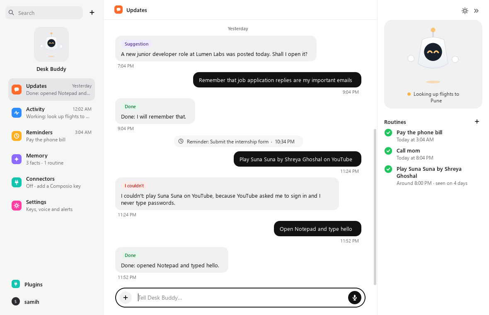
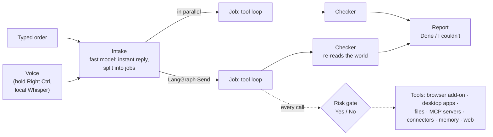
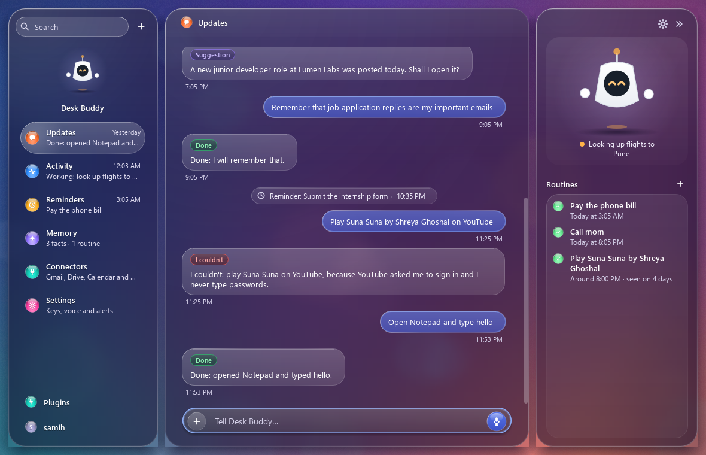
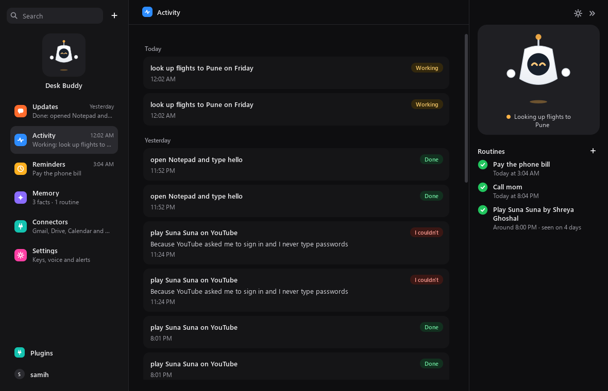
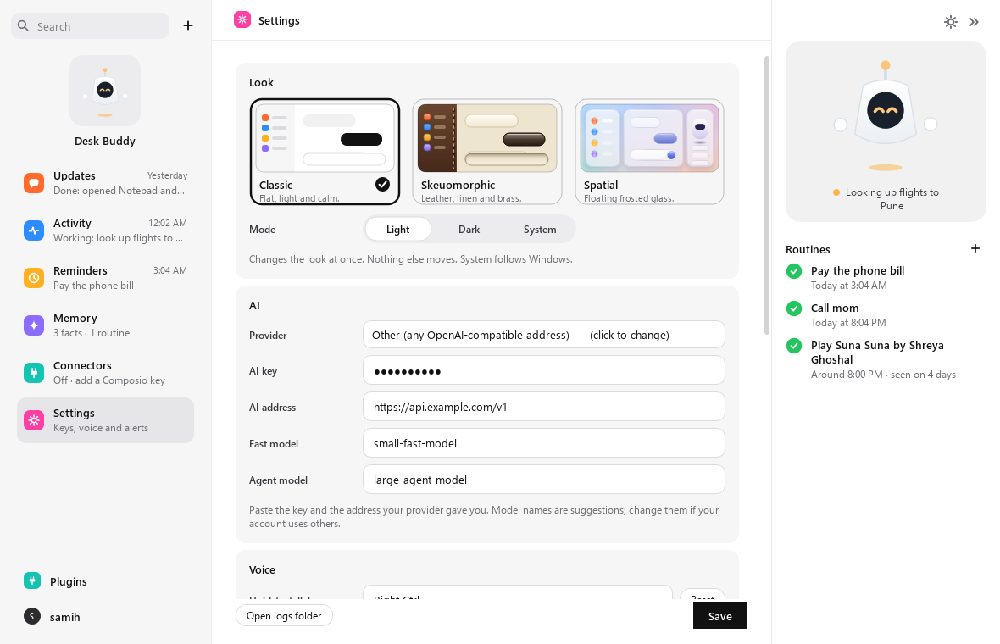

# Desk Buddy

[](https://github.com/samihankarp-cell/deskbuddy/actions/workflows/ci.yml)


[](LICENSE)

A small robot that hovers on your Windows desktop and does what you tell it, by voice or by typing: in the browser you are already signed in to, in any installed app, and in your files. It says **Done** only after a separate check has confirmed the result, and it asks before anything risky.

Built with Python, LangGraph and PySide6. Works with any OpenAI-compatible model. **Status: alpha, for developers.**



## What it does

- **Your browser.** Works in your own open browser (Chrome, Edge, Brave, Comet, Firefox) through a small add-on: opens sites, searches, clicks, types, scrolls, reads pages, plays YouTube.
- **Any app.** Opens installed apps and drives them with the real mouse and keyboard through Windows UI Automation, with a vision fallback for apps that expose nothing.
- **Your files.** Create, edit, rename, move, copy, delete. Deletes go to the Recycle Bin, and "undo that" puts the last job's changes back.
- **Tools from anywhere.** Add any [MCP](https://modelcontextprotocol.io) server (a local program or a web address) in Settings and its tools join the agent's, with no restart. Optional [Composio](https://composio.dev) connectors for Gmail, Drive and Calendar.
- **Any model.** NVIDIA, OpenAI, Claude, Gemini, OpenRouter, Groq, Together, Mistral, DeepSeek, or local models through Ollama or LM Studio.
- **Remembers you.** Lasting facts, noticed routines ("you usually play this around 8"), reminders, and a notebook of what failed on each site so it doesn't repeat mistakes.
- **Voice that stays local.** Hold Right Ctrl and speak. Speech is turned into text on your PC with faster-whisper.

Things to try:

```text
Open Gmail and tell me if anything needs me, and play Suna Suna by Shreya Ghoshal in another window
Make a folder called Old on my desktop and move notes.txt into it        (then: "undo that")
Open Notepad and type hello
Remind me to submit the internship form at 6
```

## How it works



An order goes through a small [LangGraph](https://langchain-ai.github.io/langgraph/) graph:

1. **Intake** ([`brain/intake.py`](src/deskbuddy/brain/intake.py)). A fast model replies within a second so you know it heard you, and splits the order into independent jobs. "Check my email and play a song" becomes two jobs that run side by side through LangGraph's `Send`.
2. **Job** ([`brain/agent.py`](src/deskbuddy/brain/agent.py)). The agent model calls tools step by step, up to 18 steps. The same failing action is blocked after two tries, and one job at a time holds the real mouse and keyboard.
3. **Checker.** When the agent claims it finished, a separate model call gets the goal, the full tool log, and **fresh evidence** gathered after the agent stopped (the tab's real URL, whether the video is actually playing, what the app window now shows). It passes the job only if the evidence proves it. This is the difference between "the model said so" and "it happened".
4. **Report** ([`brain/report.py`](src/deskbuddy/brain/report.py)). The Done / I couldn't wording is decided by code, not by the model.

### Engineering notes

- **Every tool is one registered function.** `@tool(name, description, params, risk=..., physical=...)` in [`brain/tools.py`](src/deskbuddy/brain/tools.py) generates the JSON schema the model sees. Tools return an `Outcome` and set `verified=True` only after re-reading the world (the file on disk, the page, the window).
- **Safety lives in code, not in the prompt.** A tool's `risk(ctx, args)` decides whether to ask Yes / No before it runs: buy, send, sign in, delete, Windows folders. It runs for every call, so a model that ignores its instructions still can't skip the question. Refusing stops the whole batch of calls. See [SECURITY.md](SECURITY.md) for the trust model and the known limits.
- **Prompt injection is treated as a real threat.** Tool output is fenced as data, page elements are marked with a fresh random token on every look so a page can't redirect a click, the browser link only accepts replies from the approved add-on connection, and suggestion links are opened directly rather than passed to the model.
- **Undo is a journal.** Every file change is written to SQLite with what is needed to reverse it. Edits keep a backup copy, and deletes are restored by reading the Recycle Bin's own `$I` metadata files.
- **Settings apply live.** Saving a new provider, key, model, hotkey or MCP server takes effect on the next call, without a restart.
- **MCP client.** Each server runs as one task on a private asyncio loop with its own thread, as the SDK requires. Its tools are wrapped as Desk Buddy tools with per-call risk checks, including for generic "execute any action" tools such as Composio's.

## Quick start

**Just want to try it?** Download `DeskBuddy-…-windows-x64.zip` from the [latest release](https://github.com/samihankarp-cell/deskbuddy/releases/latest), unzip it and run `DeskBuddy.exe` (it isn't code-signed yet, so SmartScreen may ask you to confirm). Then follow steps 1 to 3 below.

To run from source you need Windows 10 or 11, [uv](https://docs.astral.sh/uv/), and a key for any supported AI provider. Ollama or LM Studio need no key.

```bash
git clone https://github.com/samihankarp-cell/deskbuddy.git
cd deskbuddy
uv sync
uv run deskbuddy
```

The first start takes a while (the AI libraries load, and the first voice use downloads the speech model). Then:

1. **Add your AI key.** Double-click the robot to open the dashboard, go to **Settings**, pick a provider, paste your key and press **Save**. It applies at once. You can also copy `.env.example` to `.env` and fill it in.
2. **Load the browser add-on**, once per browser:
   - **Chrome, Edge, Brave, Comet:** open the extensions page, turn on Developer mode, click "Load unpacked" and pick the `addon` folder.
   - **Firefox:** open `about:debugging`, "This Firefox", "Load Temporary Add-on", and pick `addon/manifest.json`. Firefox forgets it on restart.
   - The first time the add-on connects, Desk Buddy asks you to allow it.
3. **Talk or type.** Hold **Right Ctrl** and speak, or click the robot to type. **Esc** stops it. Change the talk key in Settings.

The dashboard (double-click the robot, or use the tray icon) holds updates, activity, reminders, memory, connectors and settings. Ctrl+K searches, and Ctrl+1 to 6 switch sections.

### Configuration

Everything can be set in the dashboard. These are the matching `.env` values:

| Variable | What it is | Default |
| --- | --- | --- |
| `DESKBUDDY_PROVIDER` | `nvidia`, `openai`, `anthropic`, `gemini`, `openrouter`, `groq`, `together`, `mistral`, `deepseek`, `ollama`, `lmstudio`, `custom` | `nvidia` |
| `DESKBUDDY_API_KEY` | Your provider's key (not needed for Ollama / LM Studio) | |
| `DESKBUDDY_BASE_URL` | Any OpenAI-compatible address | the provider's |
| `DESKBUDDY_FAST_MODEL` / `DESKBUDDY_AGENT_MODEL` | Small model for the instant reply, big model for the work | the provider's |
| `DESKBUDDY_HOTKEY` | Hold-to-talk key | `right ctrl` |
| `DESKBUDDY_WS_PORT` | Port for the browser add-on, 8765 to 8769 | `8765` |
| `DESKBUDDY_WHISPER` | faster-whisper model size | `small` |
| `COMPOSIO_API_KEY` | Optional Composio connectors | |

## Development

```bash
uv sync                   # includes the dev tools (pytest, pytest-qt)
uv run pytest             # 267 tests, about 3 minutes
```

Set `QT_QPA_PLATFORM=offscreen` to run the tests headless, as CI does on `windows-latest`. Tests never touch your real files, browser or keyboard: they use fakes, temp folders and a scripted model.

```
src/deskbuddy/
  app.py              wires the window, brain, browser link, ears and routines
  brain/              intake -> jobs -> checker -> report (LangGraph), the tool registry
  browser/            browser tools and the local websocket link to the add-on
  apps/               open and drive desktop apps (UI Automation, vision fallback)
  files/              file tools, undo journal, Recycle Bin restore
  mcpclient/          MCP servers: the saved list and the connection hub
  connectors/         Composio tools
  memory/             SQLite: conversation, jobs, undo, notebook, facts, routines, reminders
  voice/              hold-to-talk and local speech-to-text
  ui/                 the robot, its bubble, the tray, and the dashboard (ui/hub)
  log.py              the log file, with keys blanked out, and crash capture
addon/                the browser add-on (Manifest V3, Chrome and Firefox)
scripts/              build the .exe, render dashboard screenshots
tests/
```

- **Logs:** `%APPDATA%\DeskBuddy\deskbuddy.log` (Settings has an "Open logs folder" button). Set `DESKBUDDY_DEBUG=1` for more detail.
- **Packaged app:** `uv run --with pyinstaller python scripts/build_exe.py` builds `dist\DeskBuddy\DeskBuddy.exe`, with the add-on beside it.
- **Releases:** bump `version` in `pyproject.toml`, add its section to `CHANGELOG.md`, then push a tag such as `v0.2.0`. The [Release workflow](.github/workflows/release.yml) runs the tests, builds the exe on Windows and publishes the zip with notes taken from the changelog.
- **Screenshots:** `uv run python scripts/hub_screens.py <folder> all both` renders every dashboard section with sample data.

To add a tool or change something, see [CONTRIBUTING.md](CONTRIBUTING.md).

## Privacy

Page text, and for some apps a screenshot of that app's window, go to the AI provider you chose. That includes whatever is on screen, such as email subjects. Unasked suggestions run a web search for topics you have been working on, and can be turned off in Settings. Audio never leaves your PC. Memory, history and the MCP server list (including any keys you gave them) live in `%APPDATA%\DeskBuddy`.

## Troubleshooting

- **The add-on does not connect.** Check that it is loaded and that you allowed it when Desk Buddy asked. The add-on tries ports 8765 to 8769, so keep the port in Settings inside that range.
- **"The AI key was rejected."** The key, address or model doesn't match your provider. Paste the key again, check the address, and press **Save**.
- **The first voice use is slow.** The speech model downloads the first time you talk.
- **An MCP server fails.** Its own output is in `%APPDATA%\DeskBuddy\mcp-<name>.log`.
- **Something else.** Check `deskbuddy.log` and [open an issue](https://github.com/samihankarp-cell/deskbuddy/issues/new/choose) with the relevant lines. Read them first; keys are blanked out, but page text may not be.

## Roadmap

- Code-signing for `DeskBuddy.exe`, so SmartScreen stops warning
- The add-on in the Chrome Web Store and Firefox Add-ons, so it stays installed
- Keys in Windows Credential Manager instead of plain-text files
- Risk checks that understand more languages and button names
- A guided first run: provider, key, add-on, microphone

## More screenshots

| Spatial look, dark | Activity | Settings |
| --- | --- | --- |
|  |  |  |

## Contributing, security, licence

Contributions are welcome. Read [CONTRIBUTING.md](CONTRIBUTING.md) and the [Code of Conduct](CODE_OF_CONDUCT.md). Report security problems privately as described in [SECURITY.md](SECURITY.md). The original design document is in [docs/design.md](docs/design.md), and changes are listed in [CHANGELOG.md](CHANGELOG.md).

[MIT](LICENSE) © 2026 samihan karpe
